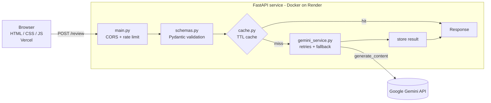

# 🤖 AI Code Reviewer & Bug Detection Platform

[](https://github.com/aarzoooooo/AI-Code-Review-Assistant/actions/workflows/ci.yml)

Paste code in **Python, Java, C++, JavaScript or C** and get a structured AI review: an overall rating, bugs (with line numbers), optimizations, best-practice issues and suggestions, powered by the Google Gemini API.

**Live demo:** _<add your Vercel URL here>_ · **API:** https://ai-code-review-assistant-1-7ctp.onrender.com/docs

> The backend runs on Render's free tier and sleeps when idle, so the first request after a pause can take 30-60 seconds.

<!-- Add a screenshot or GIF here:  -->

## Features

- REST API built with **FastAPI**; requests validated with **Pydantic** (language allow-list, 1-10,000 characters, blank code rejected)
- Structured JSON review from Gemini (schema-constrained output), rendered as cards in the UI
- **Response caching** (TTL) and **per-IP rate limiting** on `/review` to avoid redundant or abusive Gemini calls
- Retry with exponential backoff, model fallback support, and proper HTTP status codes (422 / 429 / 502 / 503)
- **pytest** suite (43 tests, Gemini fully mocked) run by **GitHub Actions** on every push
- **Docker** image for the backend; backend on **Render**, frontend on **Vercel**

## Architecture



| File | Responsibility |
|---|---|
| `backend/main.py` | Routes, CORS, rate limiting, error handlers |
| `backend/schemas.py` | Request validation and the structured review schema (also given to Gemini) |
| `backend/gemini_service.py` | All Gemini communication: prompt, retries, error mapping |
| `backend/cache.py` | Thread-safe in-memory TTL cache |
| `backend/config.py` | Environment-based settings |
| `frontend/` | Static page; renders the review using DOM APIs (no `innerHTML`, so model output can't inject HTML) |

## API

`POST /review`
```json
{ "language": "Python", "code": "for i in range(3): print(i)" }
```
→ `200`
```json
{
  "review": {
    "rating": 8,
    "summary": "...",
    "bugs": [{ "description": "...", "line": 3 }],
    "optimizations": [], "best_practices": [], "suggestions": []
  },
  "cached": false
}
```

| Status | Meaning |
|---|---|
| 422 | Invalid input (unsupported language, empty/oversized code, missing fields) |
| 429 | Rate limit exceeded (default 10 requests/minute per IP) |
| 502 | Gemini returned an error, empty response, or unparseable output |
| 503 | Gemini is busy after retries, or the server has no API key configured |

Also: `GET /` (status), `GET /health`, and interactive docs at `/docs`.

## Design decisions and trade-offs

- **Gemini is isolated in one module.** Routes and tests never touch the SDK, so tests mock a single function and CI needs no API key or network.
- **Schema-constrained JSON instead of parsing free text.** The same Pydantic model validates the response; if the model returns something malformed we return a clean 502 instead of crashing or showing garbage.
- **In-memory cache vs Redis.** An in-process TTL cache is simple, fast and has no extra infrastructure, which suits a single instance. Downsides: it's lost on restart and not shared between instances. Cache keys are a SHA-256 of language + trimmed code, and only successful reviews are cached.
- **Rate limiting by IP.** Protects the Gemini quota on a public, unauthenticated endpoint. IPs can be shared (NAT) or rotated, so it is a cost-protection measure, not strong abuse prevention. The container runs uvicorn with `--proxy-headers` so the real client IP is used behind Render's proxy.
- **Sync endpoint.** `generate_content` is a blocking call; FastAPI runs sync endpoints in a thread pool, which is simple and adequate at this scale. An async client would be the next step under heavy load.
- **Input capped at 10,000 characters.** Bounds latency, token cost and prompt-abuse surface. The prompt also tells the model to treat the submitted code as data, which reduces (but cannot eliminate) prompt injection.
- **Errors don't leak upstream details.** The client gets a generic message; the specifics are logged server-side.
- **Free-tier cold starts** are accepted; the frontend shows a "may take up to a minute" message and a 60 s timeout.

## Scaling considerations

- **Multiple instances:** move the cache and the rate-limit counters to **Redis** (slowapi supports Redis storage) so they're shared.
- **Latency under load:** switch to an async Gemini client and/or a job queue with polling, so slow reviews don't hold request threads.
- **Cost control:** per-user API keys/auth with quotas, plus a lower `RATE_LIMIT` or daily cap.
- **Large files:** chunk code by function/file and merge reviews, instead of one capped prompt.
- **Observability:** structured logs, request IDs, metrics (cache hit rate, Gemini error rate, latency).

## Run locally

```bash
cd backend
python -m venv .venv && source .venv/bin/activate      # Windows: .venv\Scripts\activate
pip install -r requirements-dev.txt
cp .env.example .env                                   # then put your GEMINI_API_KEY in it
uvicorn main:app --reload --port 8000
```
Open `frontend/index.html` with VS Code Live Server (port 5500) or any static server. On localhost the page automatically talks to `http://localhost:8000`.

### Tests
```bash
cd backend
pytest
```

### Docker
```bash
cd backend
docker build -t ai-code-review .
docker run -p 8000:8000 --env-file .env ai-code-review
```

## Configuration

| Variable | Default | Purpose |
|---|---|---|
| `GEMINI_API_KEY` | – (required) | Gemini API key |
| `GEMINI_MODELS` | `gemini-3.6-flash` | Comma-separated models, tried in order |
| `ALLOWED_ORIGINS` | localhost:5500 | Comma-separated CORS origins (set to your Vercel URL in production) |
| `RATE_LIMIT` | `10/minute` | Per-IP limit on `/review` |
| `CACHE_TTL_SECONDS` | `3600` | Cache lifetime |

## Deployment

- **Backend (Render):** Web Service, root directory `backend`, runtime **Docker**. Set `GEMINI_API_KEY` and `ALLOWED_ORIGINS=https://<your-app>.vercel.app` as environment variables.
- **Frontend (Vercel):** import the repo, set **Root Directory** to `frontend`, framework preset "Other" (static). Update `PRODUCTION_API_URL` in `frontend/script.js` if your Render URL differs.

## Tech stack

Python · FastAPI · Pydantic · Google Gemini API · pytest · Docker · GitHub Actions · HTML · CSS · JavaScript

## Author

**Aarzoo Nuha** · https://github.com/aarzoooooo
